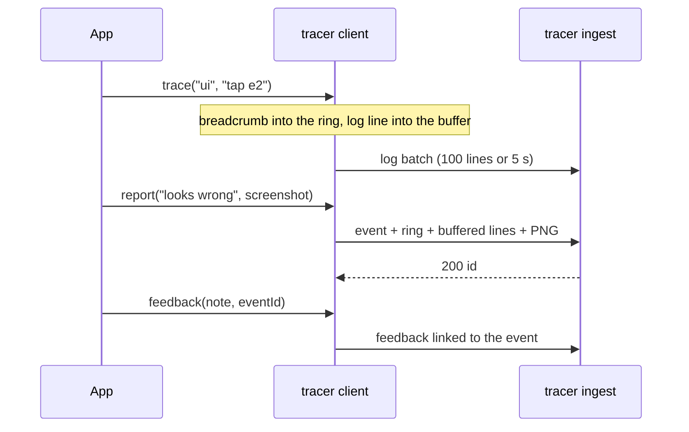

# Debug data with tracer

You want a debug build to leave a trail you can read later — the steps a player took,
the log lines around them, a screenshot of what looked wrong, and the tester's note —
without shipping a crash reporter's SDK or quota. **tracer** is the yyt platform's
collector for that, and these two packages send to it:

- [`yingyeothon_tracer_client`](../packages/yingyeothon_tracer_client/README.md) —
  pure Dart: breadcrumbs, logs, reports, feedback, the transport. Any Dart program.
- [`yingyeothon_tracer_flutter`](../packages/yingyeothon_tracer_flutter/README.md) —
  Flutter: one-call setup, screenshots, view hierarchy, lifecycle, navigation and
  error breadcrumbs, a debug-only "report this" button.

The wire format and tracer's limits are the service's (`docs/tracer.md` in
[yingyeothon/service](https://github.com/yingyeothon/service), _Wire contract for
client libraries_); this page is the app side.

## What leaves the device, and when

Breadcrumbs stay on the device in a ring of 500 until a report sends them; log lines
are the continuous timeline, sent in batches. A step you want in both calls `trace`.
A report sends the ring, the batched lines and the screenshot at once, then the note
follows as feedback:



## Get a DSN into the build

`yyt tracer dsn <res>` prints `https://{writeKey}@{host}/{trc_id}` (`--profile dev`
for a dev resource). It is a credential: pass it at build time, never in source.

```bash
flutter run \
  --dart-define=TRACER_DSN="$(yyt tracer dsn <res>)" \
  --dart-define=GIT_SHA="$(git rev-parse --short HEAD)"
```

For repeated runs keep both in a git-ignored JSON file and pass
`--dart-define-from-file=tracer.defines.json`. **Without `TRACER_DSN` the client is
off** and every call is a no-op, which is what a release build gets when it is not
given one. `GIT_SHA` becomes the `git_sha` tag and the `dist`, so whoever reads the
report can check out the exact code.

## Start it

```dart
import 'package:yingyeothon_tracer_flutter/yingyeothon_tracer_flutter.dart';

void main() {
  TracerFlutter.initUi(release: 'myapp@1.4.0+12');
  runApp(TracerScreenshot(
    child: MaterialApp(navigatorObservers: [TracerNavigatorObserver()], home: const Home()),
  ));
}
```

In a background isolate (a BLE worker, a downloader) call
`TracerFlutter.initBackground(isolate: 'ble')` first thing; each isolate has its own
client and ring, and the defines reach every isolate. A program without Flutter uses
`Tracer.init(dsn, release: …)` from the core package instead. A Flutter app depends
on `yingyeothon_tracer_flutter` only (it re-exports the core); listing both on one
`ref:` fails version solving.
**A release build stays off** even if a DSN was compiled in, unless you pass
`enableInRelease: true`. Web is not supported: a browser sends tracer's auth
header only after a CORS preflight the ingest does not answer.

## Write the trail

```dart
final tracer = Tracer.current;
tracer.trace('board', 'tap', data: {'square': 'e2'});           // breadcrumb + log line
tracer.log(TracerLevel.warning, 'move rejected', attributes: {'square': 'e2', 'ms': 12.5});
tracer.breadcrumb('ble', 'scan started');                       // only in the next report
tracer.setTag('feature', 'board');                              // on everything after
```

Attributes keep their type (`string`, `integer`, `double`, `boolean`), so the reader
can filter on `attr=square:e2`. To send the SDK's own lines as well, add
`TracerLogWriter(tracer)` to the `yingyeothon_logger` writer you already pass to the
clients (`LogWriters.combine`). tracer keeps 16 KiB of attributes per line and 64
tags; the client trims to fit and marks what it cut (`tracer.truncated`).

## Report this

Put `TracerReportButton()` in an app bar, or call
`TracerReportButton.reportThis(context)` from your own trigger. In a debug build it
sends an event with the breadcrumbs, the buffered lines, a screenshot and the view
hierarchy, then asks for a note and sends it as feedback linked to that event. In a
release build the button is empty and the call returns null.

From code that noticed something itself, send a warning event directly:

```dart
final id = await tracer.report('desync after reconnect',
    data: {'zone': zone}, error: error, stackTrace: stack);
```

## When tracer says no

The client never throws and never blocks; it waits or drops and counts in
`tracer.stats.dropped`.

| Answer | What the client does | Why you would hit this |
| --- | --- | --- |
| `401` | stops (`TracerState.stopped`) and drops the queue | the key was rotated (`yyt tracer rotate-key`) or the DSN is for another stage: rebuild with the new DSN |
| `429` | waits `Retry-After`, then resends | the resource's daily quota: ask for more with `yyt limit request --tracer <res> tracer.dailyBytes +50MiB` |
| `503` | waits `Retry-After`, else backs off 1 s → 5 min | tracer is busy, its disk is full, or your address failed too often |
| `413`, `400` | drops the envelope (`too_large`, `invalid`) | an envelope over tracer's caps or malformed; the client splits before the caps, so report it |
| no network | backs off and keeps up to 32 envelopes / 48 MiB | offline; the oldest envelope is dropped past that (`queue_full`) |

At 100 % of the quota tracer keeps events and logs but drops attachments, so a report
still lands without its screenshot.

## Verify against a local tracer

Run tracer on your machine (`tracer serve` in local mode, its README in the service
repository), point the build at it with an `http://` DSN to `127.0.0.1` — or
`10.0.2.2` from the Android emulator, or `127.0.0.1` after
`adb reverse tcp:<port> tcp:<port>` — and read back with
`curl -H "Authorization: Bearer <readToken>" http://127.0.0.1:<port>/v1/<trc>/events`.
`http` is accepted only for those hosts and only in a debug build.

## Beside a crash reporter

tracer is not crash reporting. An app that keeps Sentry for crashes initialises both;
they do not know about each other. The
[package README](../packages/yingyeothon_tracer_flutter/README.md#beside-a-sentry-crash-setup)
shows the one-line `beforeBreadcrumb` mirror for an app that wants Sentry's automatic
breadcrumbs in tracer too.
