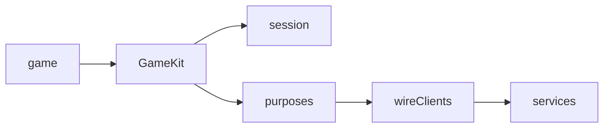

# yingyeothon_game_kit

Purpose-shaped game APIs built on the yyt wire clients: one identity and public
console config for content, save, room, turns, boards, mail, friends, matching
and Android push. The core is pure Dart; platform login, storage and lifecycle
belong to the host app.

Modules share identity and transport ownership, connecting only when used.



## Install

```yaml
dependencies:
  yingyeothon_game_kit:
    git:
      url: https://github.com/yingyeothon/flutterlib.git
      path: packages/yingyeothon_game_kit
      ref: v0.2.0
```

The new APIs are on main, pending an owner-cut release. The snippet names the
existing release; it does not claim that tag contains the new package.

## Usage

```dart
import 'package:yingyeothon_game_kit/yingyeothon_game_kit.dart';

Future<void> saveProgress(Map<String, Object?> publicConfig, String jwt) async {
  final kit = GameKit(GameKitOptions(config: GameKitConfig(publicConfig)));
  try {
    await kit.session.fromToken(jwt);
    await kit.save.load('progress');
    await kit.save.store('progress', {'level': 1});
  } finally {
    await kit.close();
  }
}
```

See the [game kit guide](../../docs/game-kit.md) for module flows and the
[playground](../../examples/playground) for an offline walk through every wave.
Wire types are not re-exported. Configuration is the public console block;
missing module config is checked on use. Tokens, Firebase device data and save
values never appear in kit diagnostics.

## Ownership and lifecycle

An injected HTTP client or session stays caller-owned. The kit owns its module
clients and an optional `lobbyFactory` result; this factory lets a game retain
its current wire lobby for positions/chat on the same socket. Identity replacement
recreates module clients. Call `setForeground(false)` on pause and true on resume;
browsers also wire visibility. Polling, retries and transient room connections
stop in background; a reconnect automatically requests state and turn logs.

`AuthSession` comes from `yingyeothon_auth_client`. The session uses monotonic
platform time; it never substitutes the device clock. Storage is opt-in and is
not enabled for shared web origins. An HTTP 401 signs out every module.

## Durable saves and turn logs

The offline queue is opt-in with `KitQueueStorage`. It stores conditional
store/remove intents before acknowledgement, isolated by auth channel, state URL,
collection and user. Replay stops on conflict and retains the record. Register
name-based merge policies for reconstruction; callback closures are not persisted.
Counters and claims always require the service. A lost write acknowledgement
may succeed when a newer revision already has exactly the intended JSON.

Turn state is deterministic RFC 8785 JSON hashed with SHA-256. A full room
payload, including kit envelope fields, is at most 8192 UTF-8 bytes. Large game
snapshots use game-defined deltas. Replay is staged, bounded, and validated
before replacing state; it never mixes responders. Host/fallback selection and
request-bound terminal markers preserve host authority by agreement.
`persist: true` writes immutable chunks, then a conditional manifest, including
an initial empty manifest. Start resumes its saved game; use `resume: false`
for a new game in the same room. Partial revisions are not restored.
`finished` and `result` expose the verified terminal state. `saveResultAs` and `resultBoard`/`scoreForResult`
configure own-player finish sinks. A matching saved receipt is restored before
replay and preserves an acknowledged board submission across reconstruction.
Persistence failure retains dirty state/results
for explicit finish or foreground retry. A rank-read failure after a successful
score write returns a submission with nullable rank and emits `refused`; it does
not report the acknowledged write as failed.

## Public API

- `GameKit`, `GameKitConfig`, `GameKitOptions`, `KitError`.
- `KitContent`, `KitSave`, `KitCounter`, `KitMerge`, `KitQueuedWrite`,
  `KitQueueStorage`.
- `KitRoom`, `KitMember`, `KitRoomEvent`, `KitInvitation`.
- `KitTurns`, `KitTurnGame`, `KitTurnEvent`, `KitJson`.
- `KitBoard`, `KitScore`, `KitMail`, `KitLetter`.
- `KitFriends`, `KitFriend`, `KitFriendRequests`.
- `KitMatchmaking`, `KitMatch`, `KitMatchStatus`, `KitPush`, `KitMessage`.

Commands are methods, events are streams. Collections are copied before retaining
or returning game state. `KitScore.period` identifies a submission's period;
`rank` can be null only when follow-up hydration failed. Retryable failures are
marked by `KitError.retryable`; its string contains module/code only.

## Differences from @yingyeothon/game-kit and Yingyeothon.GameKit

Dart reuses dedicated KV, leaderboard and social clients; match and presence are
in gamebase_client, so no separate platform package is needed. Session belongs
to auth_client and accepts host adapters. JSON values use `Object?`, methods use
Futures, and events use synchronous broadcast streams. Turn start is awaitable
so a peer can recover its announcement/log before the game is returned.
