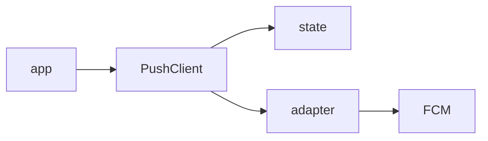

# yingyeothon_push_client

Android/FCM device registration and incoming message routing with a pure Dart
core. The host app supplies the Firebase SDK adapter; iOS is unsupported.

Registration precedes public topic subscription.



## Install

```yaml
dependencies:
  yingyeothon_push_client:
    git:
      url: https://github.com/yingyeothon/flutterlib.git
      path: packages/yingyeothon_push_client
      ref: v0.2.0
```

## Usage

```dart
import 'package:yingyeothon_push_client/yingyeothon_push_client.dart';

Future<void> connectPush(PushMessaging messaging, String jwt,
    Uri apiBase, String channel, String project, String topic) async {
  final push = PushClient(PushClientOptions(apiBase: apiBase,
    channelId: channel, token: jwt, project: project, topic: topic,
    messaging: messaging));
  await push.start();
  // On sign-out, before discarding the JWT:
  await push.unregister();
  await push.close();
}
```

The Firebase adapter is in the
[playground](../../examples/playground/lib/push/firebase_push_messaging.dart).
Call `start` on every app start and resume; token refresh re-registers automatically.
The service sweeps tokens not refreshed for sixty days. `register` also works
without a messaging adapter. Injected HTTP clients remain owned by the app.

Broadcast topics are public, grant nothing, and come from kit-config verbatim.
FCM tokens are sent only to the token registration API; the client never logs
or returns them from diagnostics. Incoming notification taps and foreground
messages use the same classifier. A match wake is only a hint: read the ticket.
Errors from asynchronous refreshes arrive on `refused`.

This change adds APIs on main; the install snippet names the existing release.
They become available at a new release when the owner cuts its tag.

## Public API

- `PushClient`, `PushClientOptions`, `PushMessaging`.
- `PushMessage`, `ClassifiedPush`, `MatchPush`, `MessagePush`, `classifyPush`.
- `PushException` (`status`, `code`, `reason`; diagnostics omit all payloads).

## Differences from @yingyeothon/push-client and Yingyeothon.PushClient

The device SDK is an injected interface, and Flutter plugins live only in the
app. Server send/campaign APIs are outside this player-facing package.
