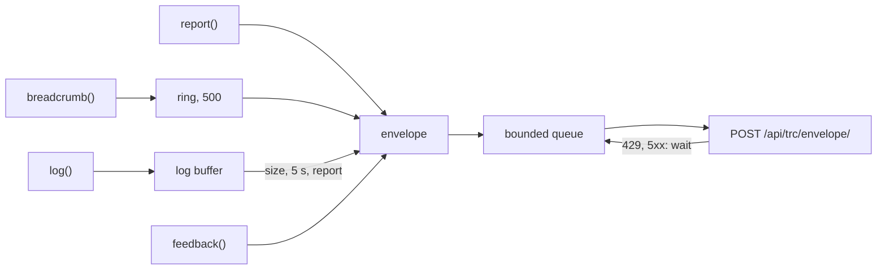

# yingyeothon_tracer_client

The pure Dart client of **tracer**, the yyt platform's debug-data collector: a
breadcrumb ring, buffered log lines, reports with a screenshot and other files, and
user feedback, sent as envelopes to tracer's Sentry-compatible ingest. It has no
Flutter and no Sentry dependency, never throws into the app, and is off when the DSN
is empty; [`yingyeothon_tracer_flutter`](../yingyeothon_tracer_flutter) adds the
Flutter glue.

Calls fill two buffers; a report or a timer turns them into envelopes on one bounded
queue:



## Install

```yaml
dependencies:
  yingyeothon_tracer_client:
    git:
      url: https://github.com/yingyeothon/flutterlib.git
      path: packages/yingyeothon_tracer_client
      ref: v0.3.1
```

A Flutter app depends on `yingyeothon_tracer_flutter` instead, which re-exports
this package.

## Usage

```dart
import 'package:yingyeothon_tracer_client/yingyeothon_tracer_client.dart';

Future<void> main() async {
  // From the build, never from source: --dart-define=TRACER_DSN="$(yyt tracer dsn <res>)"
  final tracer = Tracer.init(
    const String.fromEnvironment('TRACER_DSN'),
    release: 'mygame@1.4.0+12',
    dist: const String.fromEnvironment('GIT_SHA'), // empty → absent
    environment: 'debug',
    tags: {'feature': 'board'},
  );
  tracer.trace('ui', 'tap square', data: {'square': 'e2'}); // breadcrumb + log line
  tracer.log(TracerLevel.warning, 'move rejected', attributes: {'square': 'e2'});
  final id = await tracer.report('rejected a legal move'); // event + ring + buffered logs
  await tracer.feedback('the knight vanished', eventId: id);
  await tracer.close();
}
```

Read it back with `yyt tracer events <res> --since 10m` or the `tracer-debug` skill.

## Behaviour

The wire contract is the service's `docs/tracer.md`, _Wire contract for client
libraries_; tracer's `tracer/internal/` is the reference implementation.

- **Envelopes.** Header `{event_id?, sent_at, sdk: {name: "yyt.dart", version}}` and
  never the DSN; every item has an explicit `length`; bodies are gzipped on native
  platforms (web sends them plain). `X-Sentry-Auth: Sentry sentry_key=…,
  sentry_version=7, sentry_client=yyt-dart/<version>`.
- **A report** is one envelope: the event (message, level, `release`, `dist`,
  `environment`, tags, `user.id`, `contexts.trace`, `extra`, the breadcrumb ring, an
  exception with Dart VM frames when you pass `error`/`stackTrace`), the buffered
  log lines that fit, then the attachments. Attachments ride the report's envelope
  because tracer links a file to the envelope header's `event_id`.
- **Feedback** is its own envelope with its own id and `contexts.feedback {message,
  associated_event_id}`, without breadcrumbs (the report it links to has them).
- **Log lines** carry typed attributes (`string`, `integer`, `double`, `boolean`;
  anything else is sent as its JSON text) plus `sentry.release`,
  `sentry.environment`, `sentry.dist`, `user.id`, `device.model` (from
  `contexts.device.model`) and the tags, so tracer can filter them. `setContext`
  and `setRelease` change the contexts and the `release` of what is written after
  them, for values an app learns only after start-up (a device model read through
  a plugin); contexts stop at 32, each at 16 KiB of JSON, and `release` at 200
  bytes. tracer keeps a
  line's attributes only up to 16 KiB of JSON, so the client adds yours while they
  fit and marks the line `tracer.truncated`; a breadcrumb's `data` or a report's
  `extra` over 16 KiB becomes `{"tracer.truncated": true}`, and tags stop at 64. An
  empty `release`, `dist`, `environment` or `userId` counts as absent. A buffer is sent at `logBatchSize` (100) lines, half a mebibyte, after
  `flushInterval` (5 s), or with the next report.
- **Limits** (`TracerLimits`, from tracer's ingest): ≤ 1000 lines per log container,
  ≤ 1 MiB per JSON item (an oversized event drops its oldest breadcrumbs, then
  `extra`, then the exception; one that still does not fit is not sent, so its
  attachments are not stored alone), ≤ 2 MiB of JSON per envelope, ≤ 20
  attachments and 20 MiB less a 64 KiB gzip margin per envelope; what does not fit
  is dropped and counted.
- **Responses.** `200` sent; `401` stops the client (`TracerState.stopped`) until the
  app builds a new one with a new DSN; `429` waits `Retry-After` (300 s without
  one, or `0`), never less; `503`, other `5xx` and network errors wait
  `Retry-After` or a jittered back-off (1 s doubling to 5 min). Most of tracer's
  `503`s (busy, console, an address over its failure budget) answer before
  reading the body; the one for a body that arrives too slowly comes 10 s or
  more into the request, and on a slow link the client's own deadline may pass
  first. The third such slow refusal for one envelope — a `503` or the deadline,
  10 s or more in, with no other status between (a quick `503` or another
  network error neither counts nor restarts the count) — drops it as
  `send_failed`, so an oversized report on a bad link cannot hold the queue
  (a disk or store failure after a long upload counts too), and the queue still
  waits as told before the next one; `400`, `413` and
  other `4xx` drop and count; `415` resends once without gzip. The queue keeps
  `maxQueuedEnvelopes` (32) and `maxQueuedBytes` (48 MiB, above the largest
  envelope); the oldest envelope makes room, and the bound is soft (the newest and
  the one being sent stay).
- **Never in the way.** Every method returns at once and never throws; a failure is
  a count in `stats.dropped`. A request's deadline is `timeout` (30 s) plus a
  second per 64 KiB of body. `flush()` returns when the queue is empty or waiting
  out a back-off; `close()` gives it one `timeout`.
- **DSN.** `https://{writeKey}@{host}/{trc_id}`; `http` only to `127.0.0.1`,
  `localhost`, `::1` or `10.0.2.2`, and only with `allowHttpLoopback: true` (off by
  default; `yingyeothon_tracer_flutter` sets it in debug builds — `10.0.2.2` is the
  emulator's host alias but an ordinary LAN address on a phone). A DSN that does
  not parse turns the client off and logs one fixed line; the key is never logged.
- **Platforms.** Android, iOS, desktop and Dart servers. **Not web**: a browser
  sends the custom `X-Sentry-Auth` header only after a CORS preflight, which
  tracer's ingest does not answer, and it follows redirects regardless of
  `followRedirects`.
- **Isolates.** A client belongs to the isolate that built it; build one per
  isolate. `--dart-define`s reach every isolate.

To forward a `yingyeothon_logger` stream, compose `TracerLogWriter` (it needs
`package:yingyeothon_logger` imported; without a `client` it writes to
`Tracer.current` at each line, so it follows a re-`init`):

```dart
final logger = createFilteredLogger(
  severity: LogSeverity.debug,
  writer: LogWriters.combine([LogWriters.console, const TracerLogWriter()]),
);
```

Do not give that logger to the same client as `TracerOptions.logger`; the client
ignores what it hears from its own logger, but the loop is pointless.

## Testing

`TracerOptions` takes the HTTP client, the clock (`now`) and the `random` source of
ids and jitter, so a test pins wire bytes and back-off times with `fake_async`. The
golden envelope this library writes is `test/golden/report.envelope`; the service
repository keeps the same bytes as `tracer/testdata/envelopes/yyt-dart/report.envelope`,
where tracer's own tests ingest it.

## Public API

- `TracerClient` (`state`, `enabled`, `traceId`, `stats`, `setTag`, `setContext`,
  `setRelease`, `breadcrumb`, `log`, `trace`, `report`, `feedback`, `flush`,
  `close`), `TracerOptions`,
  `TracerState`, `TracerStats`, `TracerLevel`.
- `Tracer` (`init`, `initWith`, `current`): one process-wide client.
- `TracerAttachment` (`screenshot`, `viewHierarchy`), `TracerDsn` (`parse`,
  `tryParse`), `TracerLimits`, `TracerLogWriter`, `tracerSdkVersion`.

## Differences from @yingyeothon/tracer-client and Yingyeothon.TracerClient

- Neither exists yet; this is the first of the three clients the service plans
  (`docs/tracer.md`, _Client libraries and app integration_), and it keeps that
  page's API names (`init`, `breadcrumb`, `log`, `trace`, `report`, `feedback`,
  `flush`, `close`) for the ports to follow.
- `report` takes the screenshot as bytes: capturing one is platform glue
  (`yingyeothon_tracer_flutter` does it with a `RepaintBoundary`).
