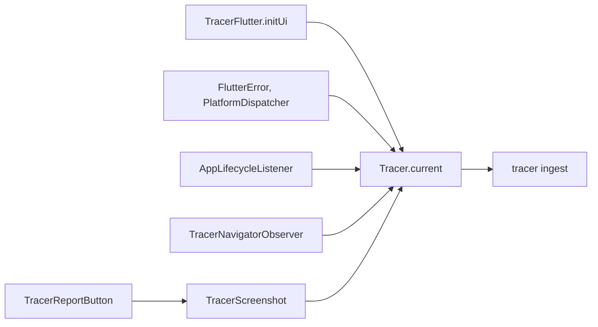

# yingyeothon_tracer_flutter

Flutter glue for [`yingyeothon_tracer_client`](../yingyeothon_tracer_client): one
call per isolate to start tracer from `--dart-define`s, screenshots through a
`RepaintBoundary`, the view hierarchy as JSON, lifecycle, navigation and Flutter
error breadcrumbs, and a debug-only "report this" button that sends an event with a
screenshot and then the user's note as feedback. **The repository's one Flutter
package**: everything testable lives in the pure Dart core; this is the thin layer
that needs `package:flutter`.

The UI isolate's hooks feed the same client the button reports through:



## Install

```yaml
dependencies:
  yingyeothon_tracer_flutter:
    git:
      url: https://github.com/yingyeothon/flutterlib.git
      path: packages/yingyeothon_tracer_flutter
      ref: v0.3.2
```

Depend on this package only: it re-exports the core (`Tracer`, `TracerLevel`, …).
Listing `yingyeothon_tracer_client` beside it on the same `ref:` fails version
solving (v0.3.0 documented that; use v0.3.1 or later).

Since v0.3.2 it depends on `device_info_plus` (13.x) and `package_info_plus`
(10.x), so the app inherits their floors: Android `minSdk` 21 and iOS 12. They are linked into release builds too, where tracer stays off.

## Usage

```dart
import 'package:flutter/material.dart';
import 'package:yingyeothon_tracer_flutter/yingyeothon_tracer_flutter.dart';

void main() {
  // TRACER_DSN and GIT_SHA from --dart-define; off when TRACER_DSN is absent.
  // The release defaults to <packageName>@<version>+<buildNumber>.
  TracerFlutter.initUi();
  runApp(
    TracerScreenshot(
      child: MaterialApp(
        navigatorObservers: [TracerNavigatorObserver()],
        home: Scaffold(
          appBar: AppBar(actions: const [TracerReportButton()]),
          body: const Text('hello'),
        ),
      ),
    ),
  );
}
```

Build with
`--dart-define=TRACER_DSN="$(yyt tracer dsn <res>)" --dart-define=GIT_SHA="$(git rev-parse --short HEAD)"`,
or keep both in a git-ignored file for `--dart-define-from-file`. The DSN is never
committed.

## What each piece does

- `TracerFlutter.initUi` makes the client `Tracer.current` — off in a release
  build unless `enableInRelease: true`, even if a DSN was compiled in — tags it `isolate: ui`
  and `git_sha`, uses the sha as `dist` (unless you pass one), sets `environment:
  debug` in a debug build and `contexts.os.name` (`Android`, `iOS`, `Linux`, …;
  before v0.3.2 the lower-case `TargetPlatform` name), and allows `http` to a
  loopback host only in a debug build. It returns at once and, unless
  `readPlatform: false`, reads the platform in the background, once per
  isolate, through `device_info_plus` and `package_info_plus`: on Android and
  iOS `contexts.device` (`model`, `manufacturer`, `brand`, `family`,
  `simulator`; on iOS the marketing name as `model`, or the hardware id when
  the plugin does not know the device, and the hardware id as `model_id`) and
  `contexts.os` (`name`, `version`); on every native platform, when you pass no
  `release`, `<packageName>@<version>+<buildNumber>` — the application id or
  bundle id on mobile, so pass your own `release` if your builds use another
  scheme. A `device` or `os` you pass in `contexts` wins. The user-set device
  name, device ids, hosts and build fingerprints are never sent. What a
  platform cannot answer stays out, and what is written before the answer
  arrives goes without it (`TracerFlutter.platformReady` completes once it is
  applied — a debug cold start on an emulator took 4 s); a
  `setContext('device', …)` or `setRelease` made before the answer is
  overwritten by it, so pass those to `initUi`. It chains `FlutterError.onError` and
  `PlatformDispatcher.onError` — each error becomes a breadcrumb with its text
  (which leaves the device only inside a report) and a log line with its type
  only, then the previous handler runs (or `FlutterError.presentError` when there
  was none) — and turns lifecycle changes into breadcrumbs, flushing on `hidden`,
  `paused` and `detached`. Errors your own `runZonedGuarded` catches never reach
  these hooks.
  **This is not crash reporting**: keep your crash reporter; the two do not know
  about each other. Calling it again swaps the client and keeps one set of hooks
  (with the first enabled call's `captureErrors` and `lifecycle`).
- `TracerFlutter.initBackground` builds a plain client for a background isolate,
  tagged `isolate: bg` (or yours). Each isolate has its own client and ring;
  `close()` it before the isolate ends, or its buffered lines are lost. It reads
  no platform plugin (a background isolate may have no channel to one), so pass
  `release` and a `device` context in `contexts` yourself — values the UI
  isolate sends it, say — if that isolate's lines should carry them.
- `TracerFlutter.dispose` restores the replaced handlers where its own are still
  installed (a crash reporter's later handler stays), forgets the platform reads
  and closes the client.
- `TracerScreenshot` wraps the app **once** (its key is global); `capture()`
  returns a PNG (pixel ratio 1) or null, `viewHierarchy()` the widget tree as
  Sentry's view-hierarchy JSON (type, depth, the key's type, position, size; no
  text and no key values; at most 2000 nodes).
- `TracerNavigatorObserver` writes `navigation` breadcrumbs (`push /board`,
  `{from, to}`).
- `TracerReportButton` is a bug button in a debug build and nothing in a release
  build. A tap sends `report` with the screenshot and the view hierarchy, then asks
  for a note (Send or Cancel) and sends it as `feedback` linked to that event. A
  second tap while one runs does nothing; profile builds have no button either.
  `TracerReportButton.reportThis` does the same from your own trigger. The note
  dialog needs a `Navigator` below the trigger, or `navigatorKey` for a button that
  sits above it.

## Beside a Sentry crash setup

Keep the app's Sentry init for crashes; initialise tracer next to it. To copy
Sentry's automatic breadcrumbs into tracer, mirror them in one line (`Tracer` comes
with this package's re-export of `yingyeothon_tracer_client`):

```dart
options.beforeBreadcrumb = (crumb, hint) {
  Tracer.current.breadcrumb(
    crumb?.category ?? 'sentry',
    crumb?.message ?? '',
    data: crumb?.data,
  );
  return crumb;
};
```

Nothing depends on it, and neither package imports the other. It also copies
Sentry's own navigation and lifecycle crumbs, so drop tracer's observer or
lifecycle hook (`lifecycle: false`) if you mirror.

## Public API

- `TracerFlutter` (`initUi`, `initBackground`, `dispose`, `platformReady`),
  `TracerDefines` (`dsn`,
  `gitSha`).
- `TracerScreenshot` (`capture`, `viewHierarchy`), `TracerNavigatorObserver`,
  `TracerReportButton` (`reportThis`).
- Re-exported from `yingyeothon_tracer_client` (documented there): `Tracer`,
  `TracerClient`, `TracerOptions`, `TracerDsn`, `TracerAttachment`, `TracerLevel`,
  `TracerLimits`, `TracerLogWriter`, `TracerState`, `TracerStats`,
  `tracerSdkVersion`.

## Differences from @yingyeothon/tracer-client and Yingyeothon.TracerClient

- Neither exists yet. Their platform extras (`window.onerror`, Unity's
  `ScreenCapture`) play the role this package plays for Flutter
  (`docs/tracer.md` in the service repository).
- It is the only `yingyeothon_*` package that imports `package:flutter`, an owner
  decision of 2026-11-08: screenshots and the widget tree cannot be read without
  it. It stays outside the pub workspace, like the example.
